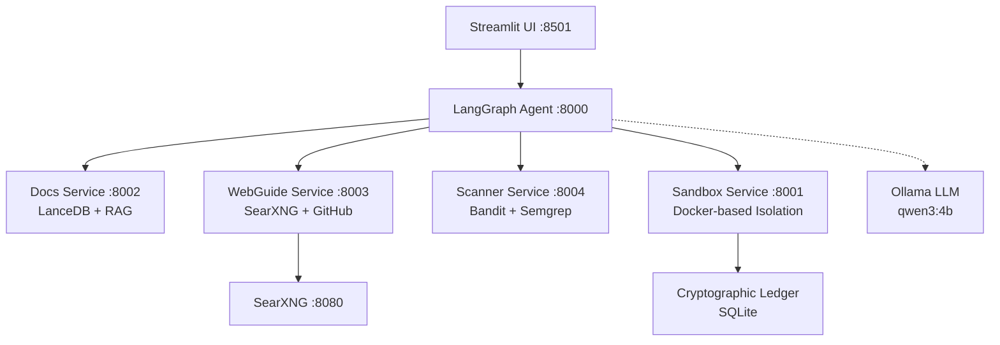

# Sourcely

<div align="center">
  

  **Local-First AI Developer Agent**

  Grounded documentation Q&A • Curated web/GitHub discovery • Isolated code execution with security scanning
</div>

---

## 🎯 Project Description

**Sourcely** is a local-first AI developer agent platform that provides:

- **Grounded Documentation Q&A**: RAG-powered search across Kubernetes, Python, and Docker documentation with accurate citations.
- **Curated Web & GitHub Resource Discovery**: Intelligent search combining SearXNG web search and GitHub API with LLM-powered ranking and summarization.
- **Isolated Code Execution**: Hardened Docker-based sandbox with static security scanning (Bandit + Semgrep) and cryptographic ledger verification.

Built with LangGraph orchestration, local Ollama LLM inference, and a microservices architecture designed for privacy and control.

---

## 🏗️ Architecture



**High-Level Flow:**

1. **User Query** → Streamlit UI sends request to Agent Service.
2. **LangGraph Router** → Analyzes intent and routes to appropriate tool(s).
3. **Tool Execution** → Docs/Web/Scanner/Sandbox service processes request.
4. **LLM Synthesis** → Ollama generates grounded response with citations.
5. **Response Display** → UI renders answer with tool pills, sources, and metadata.

---

## 🛠️ Tech Stack

| Component | Technology | Purpose |
|-----------|-----------|---------|
| **Agent Orchestration** | LangGraph + FastAPI | Dynamic tool routing with fallback logic |
| **Local LLM** | Ollama (qwen3:4b) | Privacy-first local inference |
| **Vector Store** | LanceDB | Persistent embeddings for RAG retrieval |
| **Embeddings** | sentence-transformers | Local embedding generation |
| **Web Search** | SearXNG | Privacy-respecting meta-search engine |
| **GitHub Search** | GitHub REST API | Repository and code discovery |
| **Security Scanning** | Bandit + Semgrep | AST and SAST vulnerability detection |
| **Code Execution** | Docker SDK | Isolated sandbox with security hardening |
| **Audit Trail** | SQLite + SHA-256 | Tamper-evident execution ledger |
| **UI Framework** | Streamlit | Multi-page interface with chat bubbles |
| **Container Orchestration** | Docker Compose | Local service deployment |
| **Kubernetes** | k3s + containerd | Lightweight container orchestration |
| **Ingress Controller** | Traefik | HTTP/HTTPS traffic routing |
| **Container Registry** | Docker Registry v2 | Local image storage and distribution |

---

## 🚀 Quick Start

### Prerequisites

- **Docker** and **Docker Compose** installed
- **Ollama** installed with `qwen3:4b` model pulled
- **Git** for cloning the repository

### 1. Install Ollama & Pull Model

```bash
# Install Ollama (macOS/Linux)
curl -fsSL https://ollama.com/install.sh | sh

# Windows: Download from https://ollama.com/download

ollama pull qwen3:4b
ollama list
```

### 2. Clone Repository & Configure Environment

```bash
git clone <repository-url>
cd Sourcely

# Copy environment template
cp .env.example .env

# Generate SearXNG secret key
python -c "import secrets; print(secrets.token_urlsafe(32))"

# Paste the secret into SEARXNG_SECRET
nano .env
```

Do not commit `.env` or credentials to Git.

### 3. Start All Services

```bash
cd infrastructure/docker

docker compose up --build -d
docker compose ps
```

### 4. Ingest Documentation

```bash
# Trigger documentation ingestion
curl -X POST "http://localhost:8002/ingest/all?force_reindex=true"

# Verify service health
curl http://localhost:8002/health
```

### 5. Access the UI

Open your browser and navigate to:

**http://localhost:8501**

Try these starter prompts:

- *"How do Kubernetes Liveness Probes work?"*
- *"Search GitHub repos using LangChain"*
- *"Execute Python FastAPI example"*

Navigate between tabs:

- **Agent Workspace**: Chat interface with tool routing.
- **Sandbox Studio**: Code execution with security scanning.

---

## ☸️ Kubernetes Deployment (k3s)

Sourcely is being extended to support Kubernetes deployment alongside Docker Compose. The cluster infrastructure and local registry are implemented and validated. Application deployment through Helm and ArgoCD is in progress.

### 1. Prerequisites

- Linux or Ubuntu under WSL2 (Windows)
- Docker Desktop or Docker Engine
- systemd and iptables
- Sufficient memory and disk space

For Windows development machines with limited resources, an optional `%USERPROFILE%\.wslconfig` configuration is:

```ini
[wsl2]
memory=4GB
processors=4
swap=2GB
```

Apply changes using PowerShell:

```powershell
wsl --shutdown
wsl -d Ubuntu
```

Adjust these limits according to your machine. Avoid running the full Docker Compose stack alongside Kubernetes on resource-constrained machines.

### 2. Install and Verify k3s

Run inside Ubuntu:

```bash
sudo apt update
sudo apt install -y curl iptables

# Install k3s
curl -sfL https://get.k3s.io | sh -

# Verify cluster
sudo k3s kubectl get nodes
sudo k3s kubectl get pods -A

# Verify built-in Traefik
sudo k3s kubectl get svc traefik -n kube-system
```

k3s includes containerd, CoreDNS, Traefik, Metrics Server, a network policy controller, and the Local Path Provisioner.

The Kubernetes node should be `Ready` and system workloads should be running.

Tested k3s version: `v1.37.2+k3s1`.

### 3. Deploy Local Container Registry

From the repository root:

```bash
# Create infrastructure namespace
sudo k3s kubectl apply \
  -f infrastructure/kubernetes/namespaces/infra.yaml

# Deploy registry, PVC and NodePort service
sudo k3s kubectl apply \
  -f infrastructure/kubernetes/registry/registry.yaml

# Verify resources
sudo k3s kubectl get pods,pvc,svc -n infra

# Verify registry endpoint
curl http://localhost:32000/v2/
```

The registry uses persistent storage through the `local-path` storage class and is exposed on NodePort `32000`.

Configure k3s to pull images from the HTTP registry:

```bash
sudo cp infrastructure/kubernetes/registry/registries.yaml \
  /etc/rancher/k3s/registries.yaml

sudo systemctl restart k3s
```

If an existing `registries.yaml` contains other registry settings, merge the configurations instead of overwriting the file.

### 4. Configure Docker Desktop (Windows/WSL2)

Retrieve the WSL IP address from PowerShell:

```powershell
$WslIp = ((wsl -d Ubuntu hostname -I).Trim() -split '\s+')[0]
$Registry = "${WslIp}:32000"

curl.exe -i "http://${Registry}/v2/"
```

In **Docker Desktop → Settings → Docker Engine**, add the registry address to the existing configuration:

```json
{
  "insecure-registries": [
    "<WSL_IP>:32000"
  ]
}
```

Replace `<WSL_IP>` with your actual WSL IP address, preserve existing settings, and select **Apply & Restart**.

Verify the configuration using:

```powershell
docker info
```

> The WSL IP may change after a restart. Update the Docker Engine configuration when necessary. Do not commit machine-specific IP addresses to Git.

### 5. Validate Registry Push and Pull

From PowerShell:

```powershell
docker pull hello-world:latest
docker tag hello-world:latest "${Registry}/hello-world:test"
docker push "${Registry}/hello-world:test"
```

From Ubuntu:

```bash
# Verify stored image
curl http://localhost:32000/v2/_catalog

# Pull image using containerd
sudo k3s crictl pull localhost:32000/hello-world:test

# Execute test container
sudo k3s kubectl run registry-test \
  --namespace=infra \
  --image=localhost:32000/hello-world:test \
  --image-pull-policy=Always \
  --restart=Never

# Verify execution
sudo k3s kubectl get pod registry-test -n infra
sudo k3s kubectl logs registry-test -n infra

# Clean up
sudo k3s kubectl delete pod registry-test -n infra
```

The test pod should reach `Completed` and print `Hello from Docker!`.

Docker Desktop pushes images using the WSL IP address, while k3s pulls them using `localhost:32000`.

**Security note:** The local registry uses HTTP without authentication and is intended for local development only.

### Kubernetes Roadmap

- [x] k3s cluster setup
- [x] Traefik ingress controller installation
- [x] Persistent local container registry
- [x] End-to-end image push and pull validation
- [ ] Application namespaces, ConfigMaps and Secrets
- [ ] Service Dockerfiles and Helm charts
- [ ] Application ingress routing
- [ ] Kubernetes Jobs for sandbox execution
- [ ] NetworkPolicy, ResourceQuota and restricted Pod Security
- [ ] Umbrella Helm chart and ArgoCD GitOps deployment

---

## 📊 Service Architecture

| Service | Port | Description | Key Dependencies |
|---------|------|-------------|------------------|
| **UI Service** | 8501 | Streamlit interface with deep-navy theme | Streamlit, Pillow |
| **Agent Service** | 8000 | LangGraph orchestration with tool routing | LangGraph, Ollama API |
| **Docs Service** | 8002 | RAG with LanceDB vector store | LanceDB, sentence-transformers |
| **WebGuide Service** | 8003 | SearXNG + GitHub search with ranking | httpx, GitHub API |
| **Scanner Service** | 8004 | Bandit + Semgrep security analysis | Bandit, Semgrep |
| **Sandbox Service** | 8001 | Isolated code execution | Docker SDK, SQLite ledger |
| **SearXNG** | 8080 | Privacy-respecting meta-search engine | Redis, uwsgi |

---

## 🔒 Security Features

### Sandbox Isolation

Every code execution in the Docker-based sandbox runs in a hardened container:

| Security Control | Configuration | Purpose |
|-----------------|---------------|---------|
| **User Context** | `nobody:nogroup` (65534:65534) | Reduces privilege escalation risk |
| **Filesystem** | Read-only root + tmpfs /tmp | Restricts filesystem modifications |
| **Network** | `network_mode: none` | Blocks container network access |
| **Capabilities** | All dropped (`--cap-drop=ALL`) | Removes unnecessary Linux capabilities |
| **Resources** | 0.5 CPU, 128 MB RAM, 32 PIDs | Limits resource exhaustion |
| **Timeout** | 30 seconds max | Limits execution duration |

### Cryptographic Audit Ledger

Every sandbox execution is recorded in a tamper-evident, hash-chained ledger.

Illustrative record structure:

```python
{
    "block_hash": "sha256(...)",
    "previous_hash": "sha256(...)",
    "timestamp": "2024-11-17T16:51:48Z",
    "code_hash": "sha256(...)",
    "execution_result": {...},
    "nonce": 42,
}
```

Modifications to existing records can be detected through hash-chain integrity verification.

---

## 🧪 Testing

### Run All Service Tests

From the repository root:

```bash
# Agent Service
(cd services/agent_services && pytest tests/ -v)

# Docs Service
(cd services/docs_service && pytest tests/ -v)

# WebGuide Service
(cd services/webguide_service && pytest tests/ -v)

# Scanner Service
(cd services/scanner_service && pytest tests/ -v)

# Sandbox Service
(cd services/sandbox_service && pytest tests/ -v)
```

Integration tests require the corresponding services and dependencies to be running.

### RAG Evaluation

```bash
cd evals
python run_eval.py

# Evaluates retrieval accuracy, answer quality and citation accuracy
```

---

## 📁 Project Structure

```text
Sourcely/
├── services/
│   ├── agent_services/        # LangGraph orchestration
│   ├── docs_service/          # RAG documentation search
│   ├── webguide_service/      # Web + GitHub search
│   ├── scanner_service/       # Security scanning
│   ├── sandbox_service/       # Isolated execution
│   └── ui_service/            # Streamlit UI
├── infrastructure/
│   ├── docker/
│   │   ├── docker-compose.yml
│   │   └── searxng/
│   └── kubernetes/
│       ├── namespaces/
│       │   └── infra.yaml
│       └── registry/
│           ├── registry.yaml
│           └── registries.yaml
├── docs/
│   └── adr/                   # Architecture Decision Records
├── evals/
│   ├── golden_dataset.json
│   └── run_eval.py
├── scripts/
│   └── test_tool_calling.py
└── README.md
```

---

## 🌐 API Documentation

Once the Docker Compose services are running, interactive API docs are available:

- **Agent API**: http://localhost:8000/docs
- **Docs API**: http://localhost:8002/docs
- **WebGuide API**: http://localhost:8003/docs
- **Scanner API**: http://localhost:8004/docs

---

## 📖 Architecture Decision Records

Key architectural decisions documented in `docs/adr/`:

1. **[Monorepo Modular Monolith](docs/adr/001-monorepo-modular-monolith.md)** - Single repo with microservices.
2. **[Local LLM with Ollama](docs/adr/002-local-llm-ollama.md)** - Privacy-first local inference.
3. **[LangGraph Orchestration](docs/adr/003-langgraph-orchestration.md)** - Agent workflow management.

---

## 🛠️ Development

### Local Service Development

```bash
# Example: Run docs service locally
cd services/docs_service
pip install -e ".[dev]"
uvicorn app.main:app --reload --port 8002
```

### Code Quality

```bash
# Linting
ruff check .

# Formatting
ruff format .

# Type checking
mypy app/
```

### Kubernetes Development

```bash
# Inspect workloads
sudo k3s kubectl get pods -A

# Monitor resource consumption
sudo k3s kubectl top nodes
sudo k3s kubectl top pods -A

# Stop/start the cluster when needed
sudo systemctl stop k3s
sudo systemctl start k3s
```

Permanent Kubernetes resources are maintained declaratively under `infrastructure/kubernetes/`.

---

## 📝 License

MIT License - See LICENSE file for details.