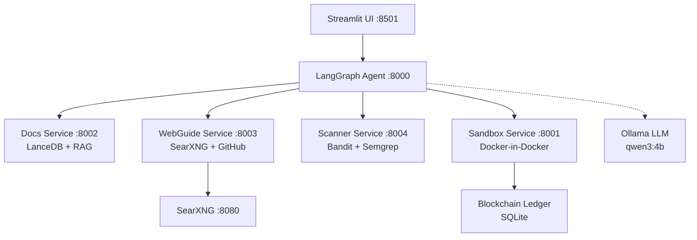

# Sourcely

<div align="center">
  
  
  **Local-First AI Developer Agent**
  
  Grounded documentation Q&A • Curated web/GitHub discovery • Isolated code execution with security scanning
</div>

---

## 🎯 Project Description

**Sourcely** is a local-first AI developer agent platform that provides:

- **Grounded Documentation Q&A**: RAG-powered search across Kubernetes, Python, and Docker documentation with accurate citations
- **Curated Web & GitHub Resource Discovery**: Intelligent search combining SearXNG web search and GitHub API with LLM-powered ranking and summarization
- **Isolated Code Execution**: Docker-in-Docker sandbox with static security scanning (Bandit + Semgrep) and cryptographic ledger verification

Built with LangGraph orchestration, local Ollama LLM inference, and a microservices architecture designed for privacy and control.

---

## 🏗️ Architecture



**High-Level Flow:**

1. **User Query** → Streamlit UI sends request to Agent Service
2. **LangGraph Router** → Analyzes intent and routes to appropriate tool(s)
3. **Tool Execution** → Docs/Web/Scanner/Sandbox service processes request
4. **LLM Synthesis** → Ollama generates grounded response with citations
5. **Response Display** → UI renders answer with tool pills, sources, and metadata

---

## 🛠️ Tech Stack

| Component | Technology | Purpose |
|-----------|-----------|---------|
| **Agent Orchestration** | LangGraph + FastAPI | Dynamic tool routing with fallback logic |
| **Local LLM** | Ollama (qwen3:4b) | Privacy-first inference without API calls |
| **Vector Store** | LanceDB | Persistent embeddings for RAG retrieval |
| **Embeddings** | sentence-transformers | Local embedding generation |
| **Web Search** | SearXNG | Privacy-respecting meta-search engine |
| **GitHub Search** | GitHub REST API | Repository and code discovery |
| **Security Scanning** | Bandit + Semgrep | AST and SAST vulnerability detection |
| **Code Execution** | Docker-in-Docker | Isolated sandbox with security hardening |
| **Audit Trail** | SQLite blockchain | Cryptographic ledger for execution logs |
| **UI Framework** | Streamlit | Multi-page interface with chat bubbles |
| **Orchestration** | Docker Compose | Service containerization and networking |

---

## 🚀 Quick Start

### Prerequisites

- **Docker** and **Docker Compose** installed
- **Ollama** installed with `qwen3:4b` model pulled
- **Git** for cloning the repository

### 1. Install Ollama & Pull Model

```bash
# Install Ollama (macOS/Linux)
curl -fsSL https://ollama.com/install.sh | sh

# Windows: Download from https://ollama.com/download

# Pull the Qwen3 4B model
ollama pull qwen3:4b

# Verify model is available
ollama list
```

### 2. Clone Repository & Configure Environment

```bash
git clone <repository-url>
cd Sourcely

# Copy environment template
cp .env.example .env

# Generate SearXNG secret key
python -c "import secrets; print(secrets.token_urlsafe(32))"

# Edit .env and paste the secret into SEARXNG_SECRET field
nano .env
```

### 3. Start All Services

```bash
cd infrastructure/docker

# Build and start all containers
docker-compose up --build -d

# Verify all 7 services are running
docker-compose ps

# Expected output:
# sourcely-ui        Up   0.0.0.0:8501->8501/tcp
# sourcely-agent     Up   0.0.0.0:8000->8000/tcp
# sourcely-docs      Up   0.0.0.0:8002->8002/tcp
# sourcely-webguide  Up   0.0.0.0:8003->8003/tcp
# sourcely-scanner   Up   0.0.0.0:8004->8004/tcp
# sourcely-sandbox   Up   8001/tcp
# sourcely-searxng   Up   0.0.0.0:8080->8080/tcp
```

### 4. Ingest Documentation

```bash
# Trigger documentation ingestion (Kubernetes, Python, Docker)
curl -X POST "http://localhost:8002/ingest/all?force_reindex=true"

# Expected response:
# {
#   "status": "success",
#   "chunks_created": 41,
#   "documents_processed": 6,
#   "time_taken": "1.25s"
# }

# Verify ingestion
curl http://localhost:8002/health
```

### 5. Access the UI

Open your browser and navigate to:

**http://localhost:8501**

Try these starter prompts:
- *"How do Kubernetes Liveness Probes work?"*
- *"Search GitHub repos using LangChain"*
- *"Execute Python FastAPI example"*

Navigate between tabs:
- **Agent Workspace**: Chat interface with tool routing
- **Sandbox Studio**: Code execution with security scanning

---

## 📊 Service Architecture

| Service | Port | Description | Key Dependencies |
|---------|------|-------------|------------------|
| **UI Service** | 8501 | Streamlit interface with deep-navy theme | Streamlit, Pillow |
| **Agent Service** | 8000 | LangGraph orchestration with tool routing | LangGraph, Ollama API |
| **Docs Service** | 8002 | RAG with LanceDB vector store | LanceDB, sentence-transformers |
| **WebGuide Service** | 8003 | SearXNG + GitHub search with ranking | httpx, GitHub API |
| **Scanner Service** | 8004 | Bandit + Semgrep security analysis | Bandit, Semgrep |
| **Sandbox Service** | 8001 | Docker-in-Docker isolated execution | Docker SDK, SQLite ledger |
| **SearXNG** | 8080 | Privacy-respecting meta-search engine | Redis, uwsgi |

---

## 🔒 Security Features

### Sandbox Isolation

Every code execution runs in a hardened Docker container:

| Security Control | Configuration | Purpose |
|-----------------|---------------|---------|
| **User Context** | `nobody:nogroup` (65534:65534) | Non-root execution prevents privilege escalation |
| **Filesystem** | Read-only root + tmpfs /tmp | Prevents persistent malware installation |
| **Network** | `network_mode: none` | Blocks data exfiltration and C2 communication |
| **Capabilities** | All dropped (`--cap-drop=ALL`) | Removes dangerous Linux capabilities |
| **Resources** | 0.5 CPU, 128MB RAM, 32 PIDs | Prevents resource exhaustion attacks |
| **Timeout** | 30 seconds max | Prevents infinite loops and DoS |

### Cryptographic Audit Ledger

Every sandbox execution is recorded in a tamper-evident blockchain ledger:

```python
{
  "block_hash": "sha256(...)",
  "previous_hash": "sha256(...)",
  "timestamp": "2024-11-17T16:51:48Z",
  "code_hash": "sha256(...)",
  "execution_result": {...},
  "nonce": 42
}
```

Any tampering breaks the hash chain and is immediately detectable.

---

## 🧪 Testing

### Run All Tests

```bash
# Agent Service
cd services/agent_services
pytest tests/ -v

# Docs Service  
cd services/docs_service
pytest tests/ -v

# WebGuide Service
cd services/webguide_service
pytest tests/ -v

# Scanner Service (22 vulnerable code snippets)
cd services/scanner_service
pytest tests/ -v

# Sandbox Service (14 adversarial scenarios)
cd services/sandbox_service
pytest tests/ -v
```

### RAG Evaluation

```bash
cd evals
python run_eval.py

# Runs 52 Q&A test cases from golden_dataset.json
# Outputs: retrieval accuracy, answer quality, citation accuracy
```

---

## 📁 Project Structure

```
Sourcely/
├── services/
│   ├── agent_services/       # LangGraph orchestration (8000)
│   ├── docs_service/          # RAG documentation search (8002)
│   ├── webguide_service/      # Web + GitHub search (8003)
│   ├── scanner_service/       # Security scanning (8004)
│   ├── sandbox_service/       # Isolated execution (8001)
│   └── ui_service/            # Streamlit UI (8501)
├── infrastructure/
│   └── docker/
│       ├── docker-compose.yml # Service orchestration
│       └── searxng/           # SearXNG configuration
├── docs/
│   └── adr/                   # Architecture Decision Records
├── evals/
│   ├── golden_dataset.json    # 52 Q&A test cases
│   └── run_eval.py            # Evaluation harness
└── scripts/
    └── test_tool_calling.py   # Integration test script
```

---

## 🌐 API Documentation

Once services are running, interactive API docs are available:

- **Agent API**: http://localhost:8000/docs
- **Docs API**: http://localhost:8002/docs
- **WebGuide API**: http://localhost:8003/docs
- **Scanner API**: http://localhost:8004/docs

---

## 📖 Architecture Decision Records

Key architectural decisions documented in `docs/adr/`:

1. **[Monorepo Modular Monolith](docs/adr/001-monorepo-modular-monolith.md)** - Single repo with microservices
2. **[Local LLM with Ollama](docs/adr/002-local-llm-ollama.md)** - Privacy-first local inference
3. **[LangGraph Orchestration](docs/adr/003-langgraph-orchestration.md)** - Agent workflow management

---

## 🛠️ Development

### Local Service Development

```bash
# Example: Run docs service locally
cd services/docs_service
pip install -e ".[dev]"
uvicorn app.main:app --reload --port 8002
```

### Code Quality

```bash
# Linting (configured in pyproject.toml)
ruff check .

# Formatting
ruff format .

# Type checking
mypy app/
```

---

## 📝 License

MIT License - See LICENSE file for details

---

## 🙏 Acknowledgments

Built with:
- **LangGraph** for agent orchestration
- **Ollama** for local LLM inference
- **LanceDB** for vector storage
- **SearXNG** for privacy-respecting search
- **Bandit & Semgrep** for security analysis
- **Docker** for isolation and deployment

---

**Status**: ✅ Production Ready | 7 Services | Deep-Navy UI Theme | Comprehensive Security
